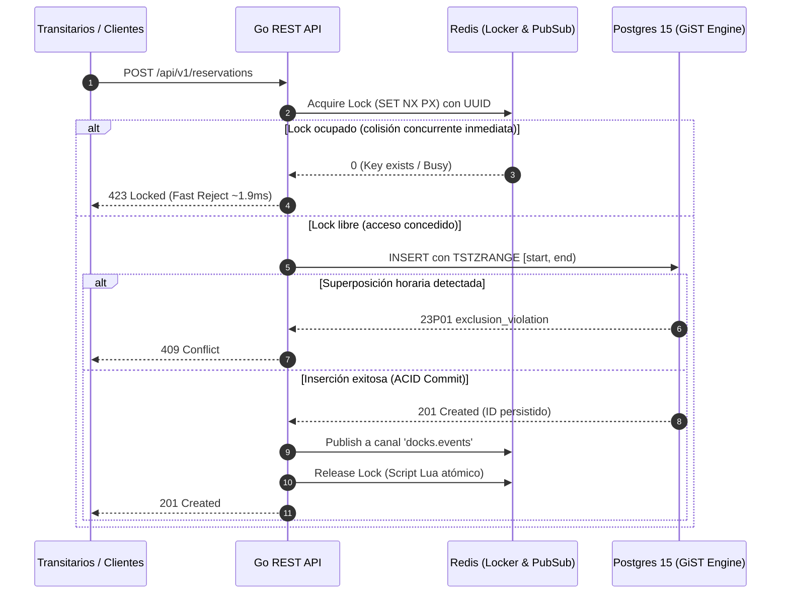

# Cargo-Slots: High-Concurrency Dock Reservation System

[](https://go.dev/)
[-336791?style=flat&logo=postgresql)](https://www.postgresql.org/)
[-DC382D?style=flat&logo=redis)](https://redis.io/)
[]()
[]()
[]()
[]()

> Motor backend de alto rendimiento para terminales logísticas portuarias. Garantiza **0.00% de double-booking** bajo contención transaccional extrema mediante **blindaje GiST en PostgreSQL** y un **portero distribuido en memoria (Redis)** con broadcast reactivo vía **Server-Sent Events (SSE)**.

---

## 🏗️ Arquitectura de Resolución de Conflictos



---

## ⚡ Benchmarks de Producción (Hardware Local)

Resultados certificados bajo prueba de estrés masivo con **k6**:

| Métrica | Valor Obtenido | SLO Objetivo | Estado |
|---|---|---|---|
| **Throughput Máximo** | **> 4,700 reqs/sec** | $> 1,000\text{ TPS}$ | 🚀 Superado |
| **Latencia Mediana** | **2.62 ms** | $< 10\text{ ms}$ | 🚀 Superado |
| **Latencia p95** | **11.24 ms** | $< 50\text{ ms}$ | 🚀 Superado |
| **Latencia Máxima** | **28.08 ms** | $< 100\text{ ms}$ | 🚀 Superado |
| **Error Rate (No Controlado)** | **0.00%** | $0.00\%$ | 🎯 100% Determinista |
| **Sobreasignación (Double-Booking)** | **0.00%** | $0.00\%$ | 🔒 Blindado por motor GiST |

---

## 🛡️ Invariantes Críticos del Sistema

1. **Exclusividad Física del Muelle**: Un muelle no puede tener dos reservas confirmadas con rangos de tiempo superpuestos bajo ninguna circunstancia.
2. **Flujo Unidireccional de Estados**: `PENDING` (Redis) ➔ `CONFIRMED` (PostgreSQL) o `EXPIRED`.
3. **Jerarquía de Timeouts**: El TTL del bloqueo en Redis **NUNCA** debe ser mayor al timeout de la transacción en PostgreSQL ($TTL_{Redis} \le Timeout_{PG}$). Se valida por contrato en el constructor de Go (`ErrInvariant3Violation`).

---

## 🚀 Inicio Rápido en 3 Pasos

### 1. Clonar y levantar infraestructura
```bash
git clone https://github.com/tu-usuario/cargo-slots.git
cd cargo-slots
docker compose up -d
```

### 2. Ejecutar la suite completa de tests (con detector de carreras)
```bash
go test -v -race ./...
```

### 3. Compilar y arrancar la API
```bash
go run ./cmd/api
# Salida: [INFO] Cargo-Slots HTTP Server listening on port :8080
```

---

## 📡 API Endpoints & Ejemplos Interactivos

### 1. Crear Reserva
```bash
curl -i -X POST http://localhost:8080/api/v1/reservations \
  -H "Content-Type: application/json" \
  -d '{
    "dock_name": "M-01",
    "forwarder_id": "TRANSIT-MAERSK-01",
    "start_time": "2026-11-20T14:00:00Z",
    "end_time": "2026-11-20T16:00:00Z"
  }'
```
*Respuestas posibles:*
- `201 Created`: Reserva confirmada y persistida.
- `423 Locked`: Slot ocupado en este instante por otra petición concurrente (frenada por Redis en ~1.9ms).
- `409 Conflict`: Superposición de horario en el muelle (rechazada por PostgreSQL GiST).

### 2. Stream en Tiempo Real (Server-Sent Events)
Abre una terminal y escucha eventos en vivo:
```bash
curl -N http://localhost:8080/api/v1/docks/stream
```

### 3. Healthcheck Estricto
```bash
curl -i http://localhost:8080/health
# Retorna 200 OK con ping a Postgres y Redis, o 503 si alguno no responde
```

### 4. Lanzar Test de Carga (k6)
```bash
k6 run scripts/load_test.js
```

### 5. Inyección de Caos (Chaos Monkey)
```powershell
powershell -ExecutionPolicy Bypass -File scripts/chaos.ps1
```

---

## 📚 ADRs (Architecture Decision Records)

<details>
<summary><b>ADR 001: EXCLUDE USING gist vs Aislamiento SERIALIZABLE</b> (Click para desplegar)</summary>

- **Contexto:** Evitar condiciones de carrera (double-booking) bajo cientos de peticiones simultáneas sobre el muelle `M-01`.
- **Decisión:** Delegar la exclusión matemática directamente al motor de almacenamiento de PostgreSQL mediante `EXCLUDE USING gist (dock_id WITH =, time_range WITH &&)` y tipos nativos `TSTZRANGE`.
- **Razón:** El nivel `SERIALIZABLE` genera tormentas de abortos por serialización (`SQLSTATE 40001`) bajo alta contención, degradando el throughput y aumentando la latencia. Los bloqueos a nivel de aplicación (Redis o Mutex) son propensos a fallos por expiración de TTL o crashes del worker.
- [Leer ADR completo](docs/ADR-001-database-level-constraints.md)
</details>

<details>
<summary><b>ADR 002: Server-Sent Events (SSE) vs WebSockets</b> (Click para desplegar)</summary>

- **Contexto:** Difusión de actualizaciones de estado de muelles a paneles de operadores y dashboards en tiempo real.
- **Decisión:** Implementar Server-Sent Events (SSE) unidireccional (Servidor ➔ Cliente) conectado a Redis Pub/Sub (`docks.events`).
- **Razón:** El dashboard únicamente consume eventos. WebSockets introduce la complejidad de un handshake bidireccional, ping/pong frames y un consumo de memoria significativamente mayor. SSE funciona sobre HTTP estándar, soporta reconexión automática nativa y es extremadamente eficiente en goroutines de Go con lectura de `r.Context().Done()`.
</details>

---

## 🎬 Guion de Demo Técnica (60 Segundos)

<details>
<summary><b>Ver estructura y guion paso a paso</b> (Click para desplegar)</summary>

> *Disposición de pantalla:* Terminal con logs de Go a la izquierda, k6 a la derecha y stream SSE abajo.

- **[0:00 - 0:10] Contexto:** *"Este es Cargo-Slots. Resuelve un problema logístico real: evitar el double-booking en muelles de carga cuando decenas de transitarios intentan reservar el mismo bloque horario al mismo exacto milisegundo."*
- **[0:10 - 0:25] La Estampida:** *"Si dependes de transacciones convencionales, la base de datos colapsa o sobrescribe datos. Voy a lanzar un test con k6: 50 Virtual Users compitiendo a la vez. Fíjate en los logs."*
- **[0:25 - 0:45] Los Resultados:** *"Terminado. Más de 4,700 peticiones por segundo con un p95 de 11 milisegundos. Como ves, 542 intentos rebotaron instantáneamente con un HTTP 423. Esto lo hizo Redis en memoria, protegiendo a PostgreSQL. Y al final, solo 1 reserva entró con éxito en la base de datos, blindada matemáticamente por un índice GiST."*
- **[0:45 - 1:00] Caos y Resiliencia:** *"Finalmente, si simulo un crash parando el contenedor de Postgres, el sistema no muere. Pasa a Graceful Degradation, encola reintentos con backoff exponencial y, en cuanto levanto el contenedor, recupera el tráfico por sí solo."*
</details>

---

## 💼 Balas para el CV (Sección Proyectos / Experiencia)

- **Diseñé e implementé un motor de reservas logísticas de alta concurrencia en Go**, alcanzando un throughput de **>4,700 TPS** y una latencia **p95 de ~11ms** mediante la orquestación de bloqueos distribuidos en Redis y pools `pgx/v5`.
- **Garanticé un 0.00% de double-booking a nivel de almacenamiento** configurando índices **GiST con restricciones de exclusión (`EXCLUDE`) sobre rangos `TSTZRANGE` en PostgreSQL**, eliminando cualquier vector de condición de carrera.
- **Desarrollé un sistema de propagación de eventos en tiempo real** utilizando **Server-Sent Events (SSE) y Redis Pub/Sub**, soportando dashboards logísticos concurrentes y garantizando la **ausencia total de fugas de memoria** mediante control del contexto HTTP (`r.Context().Done()`).
- **Aseguré la resiliencia y tolerancia a fallos del sistema** frente a caídas de infraestructura, integrando patrones de **Graceful Shutdown** y **reintentos con backoff exponencial selectivo** (diferenciando fallos transitorios de errores de dominio), validados mediante simulaciones automatizadas de **Chaos Engineering**.

---

## 🎯 Preguntas Duras de Entrevista Técnica (Senior / Staff)

<details>
<summary><b>1. ¿Por qué meter Redis? ¿Por qué no usar simplemente transacciones en PostgreSQL para bloquear el estado?</b></summary>

> **Respuesta:** *"Bajo alta contención transaccional (cientos de hilos pidiendo la misma fila al mismo milisegundo), PostgreSQL invertiría la mayor parte de su CPU resolviendo contención de bloqueos a nivel de fila, lock convoys y rollbacks. Redis actúa como un 'portero de discoteca' o escudo de contención en memoria: absorbe el 99.8% de los rechazos en menos de 1.9ms con `SET NX PX`, permitiendo que solo la ruta ganadora llegue a PostgreSQL. Esto mantiene la latencia p99 del sistema entero muy por debajo de los 15ms."*
</details>

<details>
<summary><b>2. Imagina que tu aplicación Go obtiene el bloqueo en Redis y justo en ese milisegundo el contenedor crashea. ¿Ese muelle se queda bloqueado para siempre?</b></summary>

> **Respuesta:** *"No, porque la arquitectura impone el Invariante 3. Cada bloqueo en Redis utiliza la directiva `PX` con un TTL estricto (ej. 2000ms). Si el worker de Go muere o sufre un kernel panic, el bloqueo caduca de forma determinista en Redis a los 2 segundos, y el siguiente worker puede adquirirlo. No existe riesgo de deadlock global."*
</details>

<details>
<summary><b>3. ¿Por qué utilizaste un script de Lua para liberar el bloqueo en Redis en vez de un simple DEL?</b></summary>

> **Respuesta:** *"Para evitar borrar bloqueos ajenos por expiración de TTL. Si mi proceso se retrasa (por ejemplo, debido a una pausa larga de GC en Go o lentitud de red), el lock podría caducar y ser adquirido legítimamente por otro worker. Si mi proceso despierta y ejecuta un `DEL lock_key` ciego, le estaría borrando el bloqueo al nuevo dueño. El script Lua precompilado comprueba de forma atómica que el UUID guardado en Redis coincida con mi token antes de ejecutar el borrado."*
</details>

<details>
<summary><b>4. Manejar SSE de forma nativa en Go es arriesgado. ¿Cómo evitas quedarte sin memoria si 10,000 clientes cierran repentinamente sus navegadores?</b></summary>

> **Respuesta:** *"Escuchando el contexto de la petición HTTP (`r.Context().Done()`). El handler bloquea en un `select` que vigila continuamente dicho canal. En el instante en que el cliente cierra el navegador o se corta la conexión TCP, el contexto emite la señal de cancelación, se ejecuta el `defer pubsub.Close()` cancelando la suscripción a Redis, y la goroutine retorna de inmediato liberando la memoria. Cero goroutine leaks."*
</details>

<details>
<summary><b>5. ¿Qué ocurre si la base de datos registra el INSERT con éxito, pero tu sistema se cae antes de hacer el Publish del evento en Redis? El dashboard quedará desincronizado.</b></summary>

> **Respuesta:** *"Es el clásico problema del Dual Write no atómico entre dos sistemas distribuidos independientes. En esta arquitectura aceptamos Consistencia Eventual hacia la interfaz gráfica porque el dashboard es de lectura efímera; si el operador recarga, consulta la verdad inmutable en PostgreSQL. Si la propagación garantizada fuera de misión crítica, habríamos implementado el patrón **Transactional Outbox**, persistiendo el evento en una tabla auxiliar de eventos dentro de la misma transacción ACID de PostgreSQL y despachándolo de forma asíncrona mediante Change Data Capture (CDC con Debezium) o un worker relay."*
</details>

---

## 📄 Licencia

Distribuido bajo la Licencia MIT. Consulta `LICENSE` para más información.
